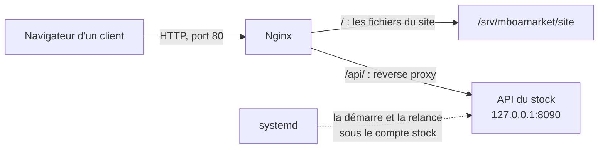

# Mboa Market — mise en production d'une boutique en ligne sur un serveur Linux

> La boutique en ligne de Mboa Market et son API du stock, en production sur Ubuntu : Nginx sert le site et protège l'API, systemd garde l'API en vie, et chaque compte n'a que les droits dont il a besoin. Avec le post-mortem d'un vrai incident de mise en production.


## Le contexte

Mboa Market est une boutique en ligne de Douala et de Montréal (une entreprise fictive). L'équipe de développement livre deux choses : le site de la boutique, et une petite API en Python qui donne le stock de chaque produit. Mon rôle, comme ingénieur DevOps : les mettre en production sur un serveur Linux, de façon sûre, et les garder en ligne.

Ce dépôt contient la configuration de ce serveur : avec lui, on reconstruit le serveur de zéro, et on voit ce qui a changé, quand, et pourquoi.

## Ce que j'ai mis en place

| Le besoin | Ce que j'ai fait | Dans ce dépôt |
|---|---|---|
| Une intégratrice met le site à jour sans être administratrice | le groupe `web`, son compte, et le dossier du site en `2775` (setgid) | — |
| Servir la boutique | Nginx, avec un site `mboamarket` et ses propres journaux | [`nginx/mboamarket`](nginx/mboamarket) |
| Garder l'API du stock en marche | un service systemd, sous un compte sans shell, relancé s'il tombe | [`systemd/mboa-stock.service`](systemd/mboa-stock.service) |
| Une seule adresse pour le site et l'API | Nginx en reverse proxy : `/api/` vers `127.0.0.1:8090` | [`nginx/mboamarket`](nginx/mboamarket) |
| Réparer une mise en production ratée | un 403 et un 502 : diagnostic, correction, post-mortem | [`docs/post-mortem-2026-11-08.md`](docs/post-mortem-2026-11-08.md) |

## Architecture



- Seul Nginx écoute sur le réseau (port 80). L'API n'écoute que sur `127.0.0.1` : on ne la joint qu'à travers Nginx.
- systemd démarre l'API avec la machine, et la relance si elle plante (`Restart=on-failure`).

##****************************************************************************************************************************

- Les clients n'accèdent jamais directement au backend : l'API n'écoute que sur 127.0.0.1, 
- et Nginx lui transmet les requêtes en coulisses. Il n'y a qu'une seule porte d'entrée, plus facile à protéger.


##****************************************************************************************************************************

## La sécurité

- L'API tourne sous le compte système `stock`, sans shell ni sudo : si elle est piratée, l'attaquant n'a presque aucun droit.
- Les intégrateurs du groupe `web` modifient le site sans être administrateurs, et personne d'autre ne peut y écrire.
- Nginx lit le site sans pouvoir le modifier.
- Ce dépôt ne contient ni mot de passe, ni clé, ni l'adresse IP du serveur.

## Structure du dépôt

```text
mboa-market-serveur/
├── README.md                        ce fichier
├── nginx/
│   └── mboamarket                   le site Nginx (dans /etc/nginx/sites-available/)
├── systemd/
│   └── mboa-stock.service           le service de l'API (dans /etc/systemd/system/)
└── docs/
    └── post-mortem-2026-11-08.md    l'incident de la version de novembre
```

## Installer sur un serveur

Il faut un serveur Ubuntu 24.04, un compte avec `sudo`, et le code livré par l'équipe de développement dans `/srv/mboamarket` : le site dans `site/`, l'API dans `stock/`.

```bash
git clone git@github.com:<ton-compte>/mboa-market-serveur.git
cd mboa-market-serveur

# Le dossier du site, pour l'équipe web
sudo groupadd web
sudo chown root:web /srv/mboamarket/site
sudo chmod 2775 /srv/mboamarket/site

# Le serveur web
sudo apt install -y nginx
sudo cp nginx/mboamarket /etc/nginx/sites-available/mboamarket
sudo ln -s /etc/nginx/sites-available/mboamarket /etc/nginx/sites-enabled/
sudo rm /etc/nginx/sites-enabled/default
sudo nginx -t && sudo systemctl reload nginx

# L'API du stock, en service
sudo useradd --system --no-create-home --shell /usr/sbin/nologin stock
sudo cp systemd/mboa-stock.service /etc/systemd/system/
sudo systemctl daemon-reload
sudo systemctl enable --now mboa-stock
```

Pour donner la main sur le site à un intégrateur : `sudo usermod -aG web <son-compte>`.

## Vérifier que tout marche

```bash
curl -I http://localhost/              # 200 : la boutique
curl -I http://localhost/promo.html    # 200 : la page des promotions
curl http://localhost/api/stock        # le stock, en JSON, à travers Nginx
systemctl status mboa-stock            # active (running)
sudo tail -n 3 /var/log/nginx/mboamarket.access.log
```


##****************************************************************************************************************************
Sur mon serveur :
- `curl -I http://localhost/` répond `301 Moved Permanently` : Nginx redirige tout vers HTTPS.
- `systemctl status mboa-stock` affiche `active (running)`.
- Le journal d'accès montre des requêtes `GET /api/stock` qui répondent `200`.

##****************************************************************************************************************************


## L'incident du 8 novembre 2026
Juste après la publication de la version de novembre, la page des promotions répondait **403** et l'API du stock **502**.
##****************************************************************************************************************************

- **Le 403** : l'outil de publication créait les nouveaux fichiers avec des droits trop restrictifs, et Nginx ne pouvait pas les lire.
- **Le 502** : la nouvelle API avait besoin de la variable `FICHIER_STOCK`,
	 annoncée dans les notes de version, mais le service systemd ne la fournissait pas, donc l'API ne répondait plus.
Le diagnostic, la chronologie, la correction et les actions pour que ça ne revienne pas sont dans le [post-mortem](docs/post-mortem-2026-11-08.md).

##****************************************************************************************************************************


## Ce que j'ai appris
##****************************************************************************************************************************

- Diagnostiquer une panne avec les journaux : le journal d'erreurs de Nginx et `journalctl -u` pour les services.
- Après la mise en ligne d'une nouvelle version, vérifier les droits des 
	fichiers et la configuration demandée (chemins, variables), pour éviter les erreurs 403 et 502.
- Remonter la chaîne quand le site ne marche pas : d'abord Nginx, puis le lien vers l'API (le port), puis l'état du service avec `systemctl status`.


##****************************************************************************************************************************

## Auteur

<Samba Dembele — [LinkedIn](https://www.linkedin.com/in/samba-dembele-b26225354/) — formation « Devenir Ingénieur DevOps » de Runbookly, atelier du 8 novembre 2026. — formation « Devenir Ingénieur DevOps » de Runbookly, atelier du 8 novembre 2026.
